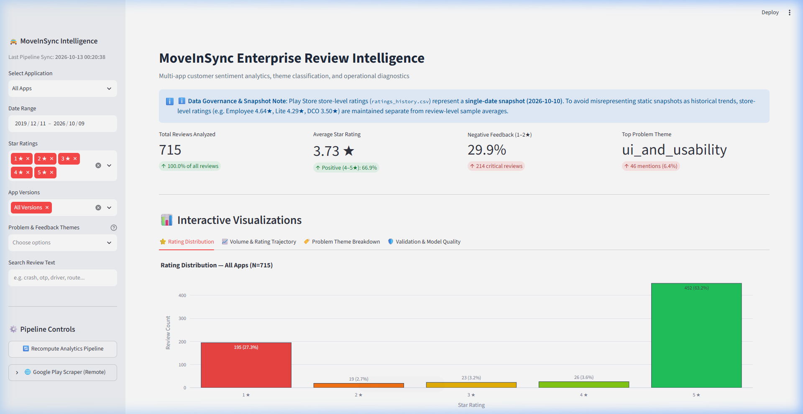
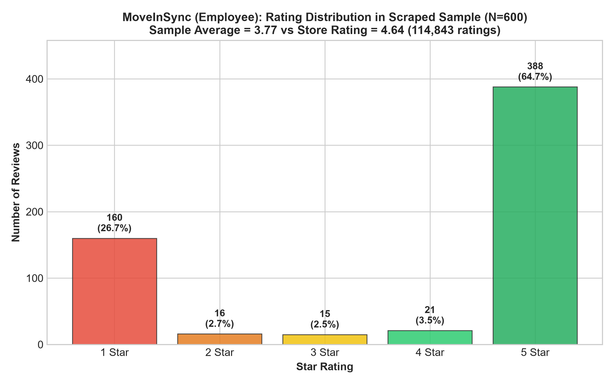
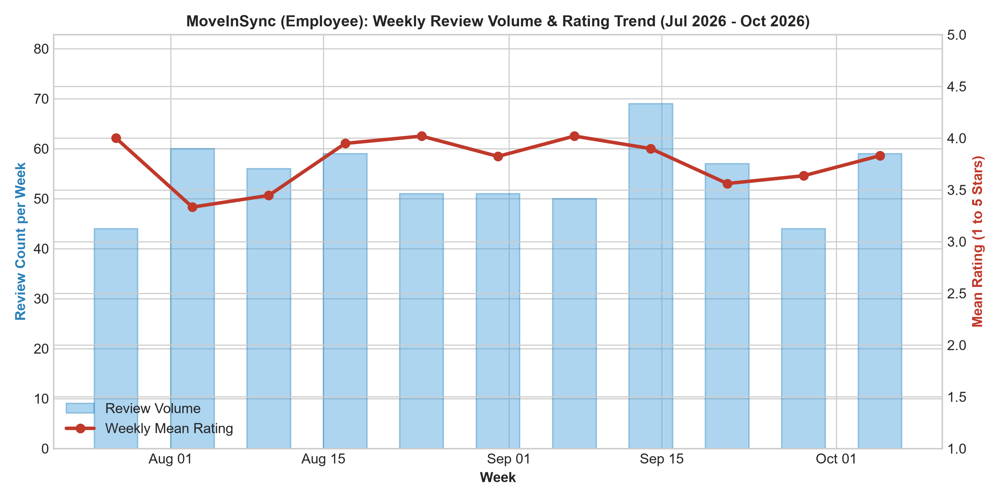
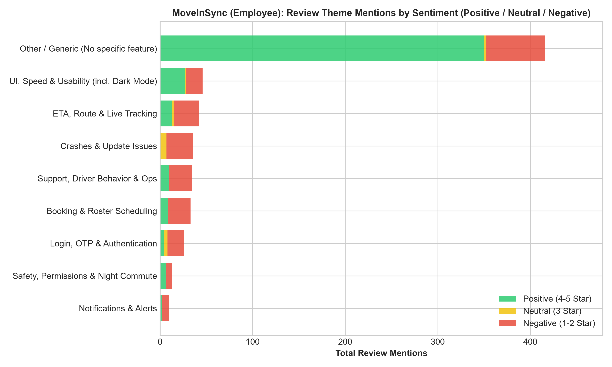
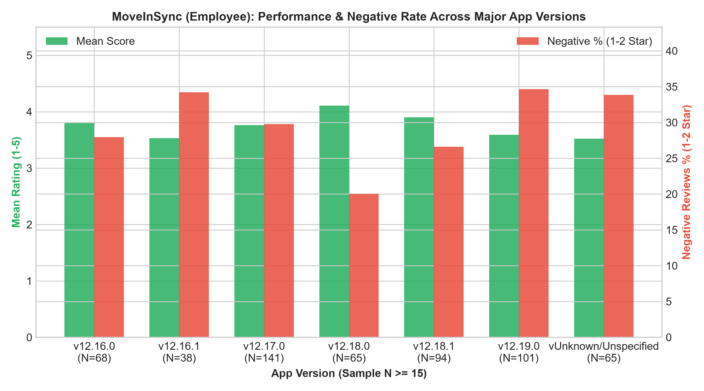

# 🚕 MoveInSync Enterprise Review Analysis & Intelligence Platform

[](https://moveinsync-application-review-analysis-tool.streamlit.app/)
[](https://www.python.org/downloads/)
[](https://github.com/Perfectionist0001/MOVEINSYNC-APPLICATION-REVIEW-ANALYSIS-TOOL)
[](https://opensource.org/licenses/MIT)
[](https://github.com/psf/black)

> **Enterprise-grade customer sentiment analytics, multi-label theme classification, analytical data engineering, and interactive visualization dashboard for MoveInSync Google Play applications.**

🔗 **Live Interactive Demo:** [https://moveinsync-application-review-analysis-tool.streamlit.app/](https://moveinsync-application-review-analysis-tool.streamlit.app/)  
📁 **GitHub Repository:** [https://github.com/Perfectionist0001/MOVEINSYNC-APPLICATION-REVIEW-ANALYSIS-TOOL](https://github.com/Perfectionist0001/MOVEINSYNC-APPLICATION-REVIEW-ANALYSIS-TOOL)

---

## 📸 Dashboard Preview



---

## 📌 Executive Summary & Project Overview

**MoveInSync** is India's premier employee commute and workplace transit automation platform. In large-scale fleet operations, end-user mobile feedback spans two interdependent user groups:
1. **Corporate Employees** commuting via automated cabs and shuttles.
2. **Cab Drivers & Fleet Partners** executing routes, tracking passengers, and logging trips.

This platform bridges the gap between raw, unstructured Google Play feedback and actionable operational intelligence. Analyzing **715 customer reviews across 3 production applications**, the system cleanses, normalizes, classifies, and visualizes feedback to identify operational friction points (e.g. GPS tracking lag, OTP validation delays, roster changes, UI usability).

### 📱 Applications Ingested

| Application | Package Identifier | Audience | Review Count | Lifetime Store Rating | Sample Avg Rating |
| :--- | :--- | :--- | :---: | :---: | :---: |
| **MoveInSync (Employee)** | `com.moveinsync.ets` | Corporate Commuters | **600** | 4.64 ★ | 3.77 ★ |
| **Moveinsync Partner - Lite** | `com.moveinsync.driver.lite` | Active Drivers | **108** | 4.29 ★ | 3.57 ★ |
| **MoveInSync - Driver Partner** | `com.moveinsync.driver.dco` | Fleet Operators | **7** *(Preliminary)* | 3.50 ★ | 2.71 ★ |
| **All Apps Combined** | *Multi-App Ingestion* | Enterprise Ecosystem | **715** | *N/A* | **3.73 ★** |

---

## 🚀 Key Technical Highlights & Engineering Feats

- 🎯 **84.0% Exact Match Classification**: Multi-label rule-based taxonomy evaluated on an independent, stratified 50-review holdout sample (`seed=101`), achieving a **0.893 Micro F1-score** and **0.0267 Hamming Loss** with zero data leakage.
- 🔄 **Multi-App Parity Pipeline**: Decoupled, configuration-driven analytical pipeline ([`analyze_reviews.py`](analyze_reviews.py)) generating a uniform 29-column schema across employee and driver applications.
- ⚡ **Interactive Streamlit & Plotly UI**: Real-time multi-app slicing, dynamic KPI calculations, multi-select theme filtering, weekly volume trajectories, and RFC-4180 CSV export.
- 🛡️ **Zero-Drift Data Governance**: Immutable raw CSV datasets protected with 100% SHA-256 cryptographic verification.
- 🧪 **31 Automated Regression Tests**: Standard library `unittest` suite guaranteeing schema compliance, idempotency, mathematical reconciliation, and edge-case safety.
- ☁️ **Cloud Native Deployment**: Fully containerized and verified live on **Streamlit Community Cloud** with 0 secrets and zero local OS dependencies.

---

## 📊 Analytical Visualizations Showcase

The pipeline automatically compiles high-resolution publication visualizations for stakeholder reporting:

| Rating Distribution | Review Volume & Rating Trajectory |
| :---: | :---: |
|  |  |
| *Bimodal customer distribution: 64.7% 5-star praise vs. 26.7% 1-star complaints.* | *Weekly rolling volume and star rating trajectory tracking release versions.* |

| Problem Themes Sentiment Breakdown | Version Performance Comparison |
| :---: | :---: |
|  |  |
| *Stacked horizontal distribution across Negative (1–2★), Neutral (3★), and Positive (4–5★).* | *Star rating variance across application release builds.* |

---

## 🧠 Multi-Label Taxonomy & Model Performance

Customer reviews frequently mention multiple operational topics within a single comment (e.g., *"Driver was late and the live map tracking was frozen"*). A traditional single-label classifier obscures these insights. Our taxonomy classifies reviews across **8 core functional categories** simultaneously:

### 🏷️ Theme Definitions

| Theme Identifier | Display Name | Core Monitored Keywords & Signals |
| :--- | :--- | :--- |
| `crashes_and_updates` | App Stability & Updates | Crash, freeze, app not opening, bugs, update loop, white screen |
| `booking_and_roster` | Booking & Roster | Schedule, shift change, roster lock, seat allotment, cancel ride |
| `eta_and_tracking` | Live Tracking & ETA | GPS inaccurate, live location stuck, delay, map freeze, wrong ETA |
| `login_and_otp` | Login & Authentication | OTP not received, password reset, account locked, biometrics |
| `notifications` | Alerts & Notifications | Trip alert missing, cab arrival notification delay, sound alert |
| `ui_and_usability` | UI & Navigation Usability | Difficult to use, bad UI, cluttered interface, button unresponsive |
| `support_and_operations` | Operations & Driver Support | Driver behavior, support escalation, unhelpful desk, call center |
| `safety_and_permissions` | Safety & App Permissions | Location permission, SOS button, panic alarm, route safety |
| `other_unclassified` | Generic Feedback | General compliments, unspecific feedback ("good", "bad", "ok") |

### 📈 Independent Holdout Validation Benchmark ($N=50$)

Evaluated on an independent, stratified 50-review holdout sample separate from initial tuning sets:

| Evaluation Metric | Observed Benchmark | Methodological Interpretation |
| :--- | :---: | :--- |
| **Exact Match Ratio (Subset Accuracy)** | **84.0%** (42 / 50 reviews) | All theme labels matched ground truth perfectly across all 9 slots. |
| **Micro F1-Score** | **0.893** | Global harmonic mean of multi-label precision and recall. |
| **Hamming Loss** | **0.0267** | Only 12 misclassified label instances out of 450 evaluated slots. |
| **Macro F1-Score** | **0.722** | Unweighted mean across categories (reflecting rare class variance). |
| **Data Leakage Guard** | **0 Overlapping IDs** | Holdout sample strictly isolated from the 30-review tuning set. |

---

## 🎛️ Interactive Dashboard Features

The Streamlit dashboard ([`dashboard.py`](dashboard.py)) offers deep diagnostic tools for product managers, fleet operators, and QA engineers:

- **Multi-App Scope Switcher**: Toggle dynamically between All Apps (715 reviews), Employee App (600 reviews), Driver Lite (108 reviews), or Driver Partner (7 reviews).
- **Executive KPI Cards**: Real-time calculation of Total Reviews, Mean Star Rating, Negative Feedback Rate (1–2★), and Top Problem Category.
- **Dynamic Multi-Dimensional Slicing**:
  - Bounded date-range slider (clamped dynamically to review timestamps).
  - Star rating toggles (1★ to 5★).
  - Version selector (with explicit support for `Unknown/Unspecified`).
  - Multi-select problem themes.
  - Case-insensitive keyword text search across review bodies.
- **Customer Review Explorer**: Card-based interface displaying rating badges, application tags, release versions, review dates, thumbs-up counts, theme badges, and configurable pagination (10, 25, 50, 100 items per page).
- **Compliant RFC-4180 CSV Download**: Generates filtered datasets with multi-line quote preservation at the click of a button.
- **Self-Healing Error Handling**: Empty filter results display informative guidance rather than crashing.

---

## 📂 Repository Directory Structure

```plaintext
D:\MOVENSYNC\
│
├── .gitignore                      # Standard Python, virtualenv, and backup exclusions
├── CHANGELOG.md                    # Keep a Changelog chronological milestone history
├── PROJECT_STATUS.md               # Live project state, checksums, and phase tracking
├── README.md                       # Comprehensive platform documentation and guide
├── requirements.txt                # Pinned dependencies (Streamlit, Plotly, Pandas, etc.)
│
├── dashboard.py                    # Interactive Streamlit application interface
├── dashboard_data.py               # Pure data transformation, filtering, and caching layer
├── analyze_reviews.py              # Core multi-app analysis and chart generation pipeline
├── scrape_reviews.py               # Incremental Play Store scraper with atomic upsert
├── config_loader.py                # Configuration loader and schema validator
├── project_status.py               # CLI live integrity and dataset verification tool
│
├── config/                         # Configuration Layer
│   ├── apps.json                   # App configurations (package IDs, slugs, names)
│   └── taxonomy.json               # Refined multi-label regex rules and theme metadata
│
├── data/                           # Immutable Raw Datasets (100% SHA-256 Verified)
│   ├── com.moveinsync.ets_reviews.csv          # Employee reviews (600 rows)
│   ├── com.moveinsync.driver.lite_reviews.csv  # Driver Lite reviews (108 rows)
│   ├── com.moveinsync.driver.dco_reviews.csv   # Driver Partner reviews (7 rows)
│   └── ratings_history.csv                     # Clean rating snapshot (3 rows)
│
├── reports/                        # Processed Datasets, Holdout Audits & Reports
│   ├── processed_all_reviews.csv               # Standardized combined dataset (715 rows)
│   ├── processed_employee_reviews.csv          # Standardized employee dataset (600 rows)
│   ├── processed_driver_lite_reviews.csv       # Standardized Driver Lite dataset (108 rows)
│   ├── processed_driver_dco_reviews.csv        # Standardized Driver Partner dataset (7 rows)
│   ├── holdout_validation_sample.csv           # 50-review holdout sample (seed=101)
│   ├── holdout_validation_results.csv          # Multi-label ground truth vs. predicted audit
│   ├── holdout_metrics_summary.csv             # Computed multi-label metrics
│   ├── taxonomy_gap_analysis.csv               # Boundary-case gap analysis audit
│   └── phase7_deployment_readiness.md          # Comprehensive deployment readiness report
│
├── charts/                         # Publication PNG Visualizations (15 Generated Charts)
│   ├── dashboard_hero_preview.png              # Live dashboard preview for README
│   ├── employee_ratings_distribution.png       # Rating distribution chart
│   ├── employee_ratings_over_time.png          # Weekly volume and rating trajectory
│   ├── negative_drivers_theme_breakdown.png    # Problem themes breakdown
│   └── ...                                     # Driver-specific comparison charts
│
└── tests/                          # Standard Library Regression Test Suite (31 Tests)
    ├── test_phase1.py              # Snapshot upsert, config loading, and schema validation
    ├── test_phase2.py              # Multi-app parity, schema uniformity, and review integrity
    └── test_phase4.py              # Dashboard filtering, KPIs, CSV export, and governance
```

---

## 🛠️ Local Environment Setup & Installation

### Prerequisites
- Python 3.11 or higher
- Git

### 1. Clone the Repository
```bash
git clone https://github.com/Perfectionist0001/MOVEINSYNC-APPLICATION-REVIEW-ANALYSIS-TOOL.git
cd MOVEINSYNC-APPLICATION-REVIEW-ANALYSIS-TOOL
```

### 2. Create and Activate Virtual Environment
```bash
# Windows PowerShell
python -m venv .venv
.\.venv\Scripts\Activate.ps1

# Linux / macOS
python3 -m venv .venv
source .venv/bin/activate
```

### 3. Install Dependencies
```bash
pip install -r requirements.txt
```

### 4. Run the Streamlit Dashboard
```bash
streamlit run dashboard.py
```
Open your browser at `http://localhost:8501`.

---

## 🧪 Running Automated Tests & Integrity Audits

### Run Full Regression Suite (31 Tests)
```bash
python -m unittest discover -s tests -p "test_*.py"
```

Expected output:
```plaintext
...............................
----------------------------------------------------------------------
Ran 31 tests in 4.016s

OK
```

### Run Project Integrity Checker
```bash
python project_status.py
```
Validates SHA-256 hashes of raw datasets, schema conformance, duplicate checks, and report counts.

---

## ⚖️ Data Governance & Methodological Disclosures

1. **Ratings History Single-Date Snapshot**:
   - `data/ratings_history.csv` represents a **single-date snapshot (`2026-10-10`)**.
   - Store lifetime ratings (Employee: 4.64★, Lite: 4.29★, Partner: 3.50★) must not be confused with sample review averages (Employee: 3.77★, Lite: 3.57★, Partner: 2.71★). Longitudinal trend claims cannot be drawn from this file.
2. **Driver Partner Sample Limitation**:
   - `com.moveinsync.driver.dco` contains only 7 public reviews in total ($N=3$ in holdout evaluation).
   - Metrics carry high variance and are explicitly flagged with yellow disclosure notices across reports and the live dashboard.
3. **Multi-Label Cardinality**:
   - Reviews frequently span multiple themes. Therefore, the sum of theme percentages across categories exceeds 100%.
4. **Voluntary Response Bias**:
   - Written feedback skews more critical (29.9% negative feedback) compared to overall app store star ratings (7.1% negative feedback).
5. **Privacy Sanitization & Redaction Protocol**:
   - Free-text review content was audited for embedded PII and identifiable details. Review `c789c25d-4efe-4fd4-8986-de67be5beeba` containing an unredacted vehicle registration plate was sanitized to `[REDACTED: Vehicle Registration]` across all public raw datasets, processed files, analytical reports, and live dashboard pipelines (`dashboard_data.py`).
   - Unredacted original source files are preserved strictly in private offline backups outside version control.
   - *Git History Disclosure*: This license plate was present in the initial commit history (`4703fee`). Sanitizing the working tree cleans the public deliverables and dashboard, but purging past commits requires Git history rewriting (`git filter-repo`), which is out of scope for this remediation.
6. **Automated Multi-Label Themes vs. Curated Problem Clusters**:
   - Automated regex taxonomy operates at token-level ($N_{\text{neg}}=8$ for `safety_and_permissions`).
   - Curated problem clusters incorporate contextual commuter reports ($N_{\text{neg}}=23$ for safety, including rude drivers and off-route drop-offs routed to operational support by automated regex). Denominators and inclusion criteria are strictly tracked.

---

## 📋 Forward Deployed Engineer Assignment Deliverables

The complete MoveInSync Forward Deployed Engineer candidate assignment deliverables are available in `reports/assignment_final_review/`:

| Deliverable | File Path | Scope & Focus |
| :--- | :--- | :--- |
| **Executive Submission Brief** | [`reports/assignment_final_review/submission_summary.md`](reports/assignment_final_review/submission_summary.md) | 2–3-page executive brief covering root-cause hypotheses, priority ranking, and 30-day plan. |
| **Detailed Analytical Report** | [`reports/assignment_final_review/final_assignment_report.md`](reports/assignment_final_review/final_assignment_report.md) | Exhaustive problem discovery, data reconciliation, release regression audit, and governance. |
| **Review Audit & Evidence Validation** | [`reports/assignment_final_review/review_audit.md`](reports/assignment_final_review/review_audit.md) | Methodological audit reconciling automated taxonomy vs. manual clusters and version figures. |
| **Prioritized Recommendations Matrix** | [`reports/assignment_final_review/prioritized_recommendations.csv`](reports/assignment_final_review/prioritized_recommendations.csv) | Full tabular action matrix with owners, evidence IDs, provisional targets, and risks. |
| **Measurement Framework** | [`reports/assignment_final_review/measurement_framework.csv`](reports/assignment_final_review/measurement_framework.csv) | Technical KPIs, observation baseline windows, formulas, and data streams. |

---

## 📄 License & Attribution

Developed by **Nikhil Singh** as a comprehensive enterprise data engineering, NLP classification, and dashboard analytics case study.  
Released under the [MIT License](LICENSE).
