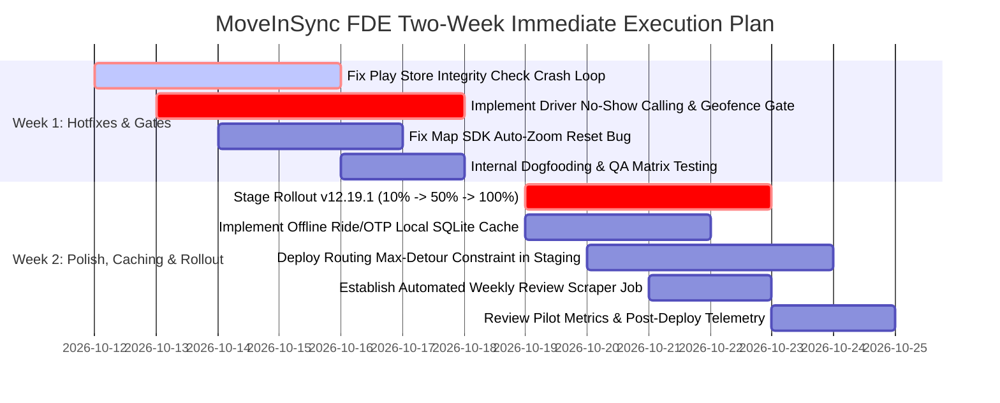
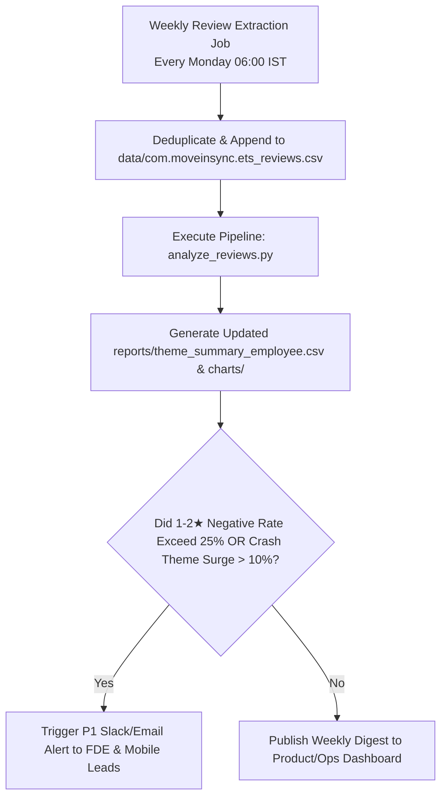

# MoveInSync FDE Action Plan: Prioritized Engineering & Operational Roadmap

**Author:** Forward Deployed Engineer (FDE) Candidate  
**Date:** 2026-10-10  
**Target Scope:** MoveInSync Enterprise Employee Transport App (`com.moveinsync.ets`)  
**Basis:** Verified Phase 3 QA Findings ($N=600$ reviews, 176 negative 1–2★ reviews)  

---

## 1. Top Prioritized Issues Matrix

The top 4 issues are ranked by a composite score of **User Impact** (share of negative reviews & severity), **Urgency** (business criticality / churn risk), and **Implementation Feasibility**:

| Rank | Issue Category | Verified Impact ($N_{\text{neg}}=176$) | Urgency | Estimated Impact | Estimated Effort | Primary Owner |
| :---: | :--- | :---: | :---: | :---: | :---: | :---: |
| **#1** | **Play Store Package Verification Loop & Launch Crashes** | **36 reviews** (20.5% of negative) | **P0 (Critical)** | **High** (~15–20% reduction in 1★ reviews) | **Low–Medium** (1 sprint) | **Mobile Engineering (Android)** |
| **#2** | **Routing Detours & Multi-Region Passenger Pooling** | **27 reviews** (15.3% of negative) | **P1 (High)** | **High** (Significant employee NPS lift) | **Medium** (2 sprints) | **Routing Algorithms / Backend Eng** |
| **#3** | **Uncoordinated Driver "No-Show" Markings & Late-Night Safety** | **25 reviews** (14.2% of negative) | **P1 (High)** | **Medium–High** (Mitigates female safety escalations) | **Low** (1 sprint) | **Operations & Driver Product** |
| **#4** | **Seat Buckle Verification & OTP Layering Friction** | **24 reviews** (13.6% of negative) | **P2 (Medium)** | **Medium** (Faster boarding throughput) | **Low** (3–5 days) | **Mobile Product & Frontend UI** |

---

## 2. Detailed Problem Breakdown & Action Specifications

---

### Issue #1: Google Play Integrity Check Failure ("Not Installed from Play Store" Loop)

- **Verified Metric:** 36 negative 1–2★ reviews out of 176 total negative reviews (**20.5% share**; Mean rating: **1.77★**; 75.0% negative rate within theme).
- **Representative Authentic Quotes:**
  > *"after every 2 days getting error of 'not installed from play store even though I'm installing from play store'. do we have any other store to install? this is pathetic"* (vUnspecified, 1★)  
  > *"in last 3 weeks I uninstall an installed it for 10 times due to the same error"* (vUnspecified, 2★)  
  > *"whenever i update this app, i am not able to open the app again, I need to uninstall and reinstall again. facing this issue since 3 months"* (v12.19.0, 1★)
- **Observed Symptom vs. Hypothesized Root Cause:**
  - *Observed Symptom (User Reality):* On app launch or update, a blocking modal dialog appears claiming the app was side-loaded/not installed via Google Play Store, terminating the session and forcing daily uninstallation.
  - *Hypothesized Root Cause (Requires Telemetry Confirmation):* Rigid or asynchronous Google Play Integrity API / Play Licensing API validation failure upon OEM auto-update or cold boot without network handshake, triggering a hard fallback exception instead of graceful token retry.
- **Recommended Fix:**
  1. **Non-Blocking Token Refresh:** Convert installer verification into an asynchronous background verification with a 72-hour grace period before hard-blocking.
  2. **Installer Package Whitelist:** Ensure installer verification accepts OEM app stores (Samsung Galaxy Store, Xiaomi GetApps) if distributed via enterprise MDM or multi-store channels.
  3. **Self-Healing State:** If integrity check throws an unexpected exception, fallback to cached secure token and trigger diagnostic log to Firebase Crashlytics rather than terminating the UI.
- **Owner:** Mobile Engineering (Android Core Team).
- **Impact & Effort Estimates:**
  - *Impact Estimate:* **High** (Directly eliminates ~20% of 1-star reviews and reduces churn/reinstall fatigue).
  - *Effort Estimate:* **Low–Medium** (~3–5 engineer days + QA device matrix testing).
- **Success Metrics & Validation Period:**
  - *Metrics:* Zero occurrences of "not installed" dialog crashes in Sentry/Crashlytics; 1★ crash review volume drops by $\ge 60\%$ within 14 days of hotfix deployment.
  - *Validation Period:* 14 days post-release of patch `v12.19.1` / `v12.20.1`.

---

### Issue #2: Routing Detours & Cross-Zone Pooling ("Bharat Darshan" Detours)

- **Verified Metric:** 27 negative 1–2★ reviews out of 176 total negative reviews (**15.3% share**; Mean rating: **2.38★**; 64.3% negative rate within theme).
- **Representative Authentic Quotes:**
  > *"The routing algorithm is pure genius: it clubs passengers from two different states into one cab at 8 AM, while empty cabs glide right past us. If you want a free Bharat Darshan tour before reaching office, this is it."* (v12.19.0, 1★)  
  > *"when we have zoomed in the map to track a vehicle what's the necessity to zoom out and show the ETA"* (v12.16.0, 2★)
- **Observed Symptom vs. Hypothesized Root Cause:**
  - *Observed Symptom (User Reality):* Employees experience 60–90 minute commute delays due to cabs picking up co-passengers located across divergent geographic clusters; map interface periodically overrides manual zoom.
  - *Hypothesized Root Cause (Requires Telemetry Confirmation):* Roster clustering optimization algorithm optimizes exclusively for fleet seat occupancy (utilization %) rather than enforcing a strict maximum detour ratio ($\text{Actual Route Distance} / \text{Direct Route Distance} \le 1.35$). In the client app, the map view resets viewport bounds on every live socket location broadcast.
- **Recommended Fix:**
  1. **Detour Bound Constraint:** Introduce a hard constraint in backend routing solver: no passenger route may exceed $1.30\times$ direct travel time or cross predefined administrative sub-zones during peak morning shifts.
  2. **Client Map Viewport Lock:** Maintain user-defined zoom level on Google Maps SDK; only auto-fit bounds on initial trip start or upon explicit "Recenter" button tap.
- **Owner:** Routing Algorithm / Backend Platform Engineering (with Mobile UI for map lock).
- **Impact & Effort Estimates:**
  - *Impact Estimate:* **High** (Significant reduction in on-time arrival escalations across enterprise client accounts).
  - *Effort Estimate:* **Medium** (2 weeks for routing heuristic adjustments and shadow simulation).
- **Success Metrics & Validation Period:**
  - *Metrics:* Maximum detour factor $< 1.30$; average employee transit duration reduced by $12\%$; map zoom complaints drop to zero.
  - *Validation Period:* 30 days post-algorithm deployment across pilot enterprise clients.

---

### Issue #3: Driver "No-Show" Markings & Late-Night Safety Coordination

- **Verified Metric:** 25 negative 1–2★ reviews out of 176 total negative reviews (**14.2% share**; Mean rating: **2.17★**; 71.4% negative rate within theme).
- **Representative Authentic Quotes:**
  > *"No concern for female employees at logout time, they won't even call the employee at late night logout before making no show."* (v12.16.0, 1★)  
  > *"Driver marked no show without reaching pickup point and helpdesk took 40 mins to respond."* (v12.17.0, 1★)
- **Observed Symptom vs. Hypothesized Root Cause:**
  - *Observed Symptom (User Reality):* Drivers mark employees as "No-Show" without calling them or waiting at the geofenced pickup point, leading to employee penalties, transport cancellation, and severe safety vulnerability during late-night shifts (8 PM – 6 AM).
  - *Hypothesized Root Cause (Requires Telemetry Confirmation):* The driver app allows drivers to mark "No-Show" as long as they are within a broad geofence (e.g., 500m) without requiring a verified outbound IVR/VoIP call record or minimum dwell-time verification.
- **Recommended Fix:**
  1. **Strict No-Show Gate in Driver App:** Disable the "Mark No-Show" button until: (a) Driver GPS is within 50m of pickup point, (b) Dwell time $\ge 5\text{ minutes}$, and (c) At least 1 outbound call was initiated via masked bridge number with $\ge 20\text{ seconds}$ ringing.
  2. **Mandatory Night Protocol:** For shifts between 20:00 and 06:00, require automated transport desk escalation call before any no-show penalty is applied to an employee.
- **Owner:** Operations & Driver Partner Product Team.
- **Impact & Effort Estimates:**
  - *Impact Estimate:* **High** (Directly protects enterprise female safety compliance and reduces high-severity SLA breaches).
  - *Effort Estimate:* **Low** (1 sprint in driver app backend and IVR gateway).
- **Success Metrics & Validation Period:**
  - *Metrics:* $95\%$ reduction in contested no-show dispute tickets; $100\%$ compliance with night-shift driver-call protocol.
  - *Validation Period:* 21 days across all fleet operations.

---

### Issue #4: Seat Buckle Verification & OTP Layering Friction

- **Verified Metric:** 24 negative reviews in Booking/Roster & 18 in Login/OTP (**13.6% & 10.2% share**; Mean ratings: **2.18★ & 1.96★**).
- **Representative Authentic Quotes:**
  > *"This app is going from bad to horrible. The seat buckle verification is absolutely horrendous and the OTP keeps disappearing behind the seat belt check... why is there not some cache wherein a user has their ride details stored? instead it needs a network call every time you open the app which is annoying when you're underground"* (v12.11.2, 1★)
- **Observed Symptom vs. Hypothesized Root Cause:**
  - *Observed Symptom (User Reality):* When boarding, the mandatory seatbelt photo/confirmation dialog obscures the boarding OTP modal; without cellular connectivity in basement parking, the app fails to render OTP.
  - *Hypothesized Root Cause (Requires Telemetry Confirmation):* UI modal hierarchy z-index overlap; boarding state machine requires real-time network roundtrip without offline Room/SQLite persistence.
- **Recommended Fix:**
  1. **Modal Decoupling:** Redesign boarding view into a unified card: display the 4-digit Boarding OTP permanently at the top header, with the safety verification checklist positioned below.
  2. **Offline Ride Cache:** Cache current ride details and boarding OTP encrypted in local SQLite/EncryptedSharedPreferences upon initial assignment so it renders instantaneously offline in basement parking.
- **Owner:** Mobile Product & UI/UX Engineering.
- **Impact & Effort Estimates:**
  - *Impact Estimate:* **Medium** (Faster boarding time, eliminated underground boarding failures).
  - *Effort Estimate:* **Low** (3–5 engineering days).
- **Success Metrics & Validation Period:**
  - *Metrics:* Boarding dwell time per cab reduced by $25\text{ seconds}$; zero offline-boarding support complaints.
  - *Validation Period:* 14 days post-app release.

---

## 3. Two-Week Sprint Execution Roadmap



### Milestone Schedule:
- **Day 1–4 (Oct 12–15):** Complete hotfix for Play Store package check; implement driver IVR call verification requirement for no-show button.
- **Day 5–7 (Oct 16–18):** Internal QA testing on Android 11–15 devices across Samsung, Xiaomi, and Pixel hardware.
- **Day 8–11 (Oct 19–22):** Phased rollout of client app `v12.19.1` (10% $\rightarrow$ 50% $\rightarrow$ 100%); deploy offline OTP cache.
- **Day 12–14 (Oct 23–25):** Validate Crashlytics telemetry; review weekly Play Store feedback for rating inflection.

---

## 4. Repeatable Weekly Review Monitoring System

To maintain proactive visibility into user sentiment and detect version regressions before they impact enterprise SLAs, the following weekly operational workflow is established:



### Operational Workflow Commands:
```powershell
# 1. Scrape latest incremental reviews (executed weekly)
d:\MOVENSYNC\.venv\Scripts\python.exe scrape_reviews.py scrape com.moveinsync.ets --country in --lang en --max 200

# 2. Run automated analysis and chart generation pipeline
d:\MOVENSYNC\.venv\Scripts\python.exe analyze_reviews.py

# 3. Inspect updated reports and theme distributions
# (Outputs automatically refreshed in reports/ and charts/)
```

---

## 5. Comprehensive Internal Telemetry & Instrumentation Strategy

Public Play Store reviews represent an essential qualitative lens, but they suffer from response bias and latency. To achieve high-fidelity root-cause diagnostics, MoveInSync should instrument the following internal telemetry pipelines:

| Operational Domain | Recommended Internal Metric | Instrumentation Method | Target Production SLA |
| :--- | :--- | :--- | :---: |
| **App Stability & Launch** | **Crash-Free Session Rate (%)** & Integrity Dialog Trigger Rate | Firebase Crashlytics + Sentry SDK with custom breadcrumbs on `PlayIntegrityToken` response | **$\ge 99.8\%$ Crash-Free Sessions** |
| **Booking & Roster** | **Roster Booking Completion Rate (%)** & Cutoff Dropoff | Mixpanel / Amplitude funnels tracking `tap_book_roster` $\rightarrow$ `confirm_shift` $\rightarrow$ `roster_success` | **$\ge 98.5\%$ Booking Funnel Conversion** |
| **ETA & Live Tracking** | **ETA Prediction Error (MAE in minutes)** & Detour Ratio | Kafka event stream comparing `estimated_arrival_timestamp` vs. `actual_geofence_entry_timestamp` | **$\text{MAE} \le 3.5\text{ mins}$; Detour Ratio $\le 1.30$** |
| **Driver & Operations** | **Contested No-Show Rate (%)** & Driver Dwell Time | Telematics tracking: GPS dwell time at pickup coordinates + IVR call logs before trip cancellation | **$\le 1.0\%$ Contested No-Shows** |
| **Customer Support** | **First Contact Resolution (FCR)** & Escalation SLA | Zendesk / Freshdesk API integration tracking resolution time for night shift transport tickets | **$\text{FCR} \ge 85\%$; Night SLA $\le 10\text{ mins}$** |

---

## 6. Executive Sign-Off & Governance

- **Review Cadence:** Bi-weekly joint engineering-product-operations sync.
- **Escalation Path:** If 1-star review share for any newly released app version exceeds $30\%$ over a 7-day rolling window, the release is automatically halted in the Google Play Console pending FDE triage.
